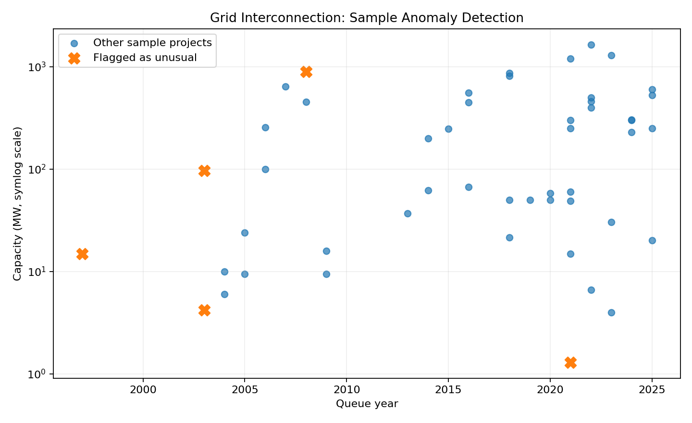

# Grid Interconnection — Real ML Demonstration

**Publisher:** IT Altitudes Inc.

## What this does

A reproducible **Isolation Forest** anomaly detection example trained on the **50-row GitHub preview**. It examines project capacity (`mw_1`, log-transformed) and queue year (`q_year`). It does **not** predict project success, operational status, or financial risk.

## Actual sample results

- Preview records: 50
- Valid records analyzed: 50
- Unusual observations flagged: 5
- Algorithm: Isolation Forest, 200 trees, contamination=0.10, random_state=42



## Reproduce

```bash
pip install pandas numpy scikit-learn matplotlib
python run_grid_ml.py
```

The script reads `grid_preview_50.csv` and writes `grid_ml_results.csv`.

## Files

- `grid_preview_50.csv`: original 50-row preview exported from the provided workbook
- `run_grid_ml.py`: runnable ML code
- `grid_ml_results.csv`: actual generated scores and flags
- `grid_ml_chart.png`: capacity-versus-queue-year visualization

## Important limitations

- The 50-row sample is not representative of the full 38,201-record dataset.
- The contamination parameter intentionally flags approximately 10% of valid rows.
- An anomaly flag is **not** evidence of an error, project risk, or future outcome.
- Capacity units should be verified against the original Berkeley Lab codebook.
- This is an educational demonstration, not a validated predictive model.
- Original data source: Lawrence Berkeley National Laboratory, [Queued Up](https://emp.lbl.gov/queues); observe applicable attribution and licensing requirements.

[Explore the full dataset listing](https://italtitudes.gumroad.com/l/lavlcx)
